<!--
  BYL0KE · GitHub Profile README
  Repositorio público: https://github.com/Byl0ke/Byl0ke
  Recursos: assets/byl0ke-header.svg y .github/workflows/snake.yml
  Nota: GitHub no ejecuta JavaScript ni CSS libre dentro de archivos README.
  Las animaciones se realizan mediante SVG e imágenes generadas externamente.
-->

<div align="center">

  

  <br/>

  <a href="https://github.com/Byl0ke">
    
  </a>

  <p>
    <a href="https://github.com/Byl0ke?tab=repositories"></a>
    <a href="https://www.youtube.com/@Byl0ke"></a>
    <a href="https://visionv-studios.tebex.io"></a>
  </p>

  <p>
    
    
    
  </p>

  <sub><a href="#about">Sobre mí</a> &nbsp;·&nbsp; <a href="#services">Qué hago</a> &nbsp;·&nbsp; <a href="#projects">Proyectos</a> &nbsp;·&nbsp; <a href="#stack">Tecnologías</a> &nbsp;·&nbsp; <a href="#activity">Actividad</a> &nbsp;·&nbsp; <a href="#contact">Contacto</a></sub>

</div>

---

<a id="about"></a>
## 01 / Sobre mí

### Hola, soy Byl0ke. Creo, diseño y desarrollo proyectos digitales.

Me dedico a transformar ideas en **sitios web, aplicaciones, sistemas personalizados e identidades digitales**. Disfruto tanto de la parte técnica —lógica, integración y rendimiento— como de los detalles que hacen que una experiencia se sienta profesional: **diseño, animación, claridad y facilidad de uso**.

He trabajado en proyectos relacionados con **FiveM, servicios para comunidades, comercio electrónico, herramientas para negocios y experiencias online**. Desarrollo iniciativas propias y sigo ampliando mis conocimientos en automatización e inteligencia artificial.

```text
BYL0KE / HOW I WORK
> idea        → entender el problema
> design      → definir una experiencia clara
> development → construir funciones útiles
> iterate     → probar, corregir y mejorar
```

<a id="services"></a>
## 02 / Áreas en las que trabajo

<table>
  <tr>
    <td width="50%" valign="top">
      <h3>🌐 Desarrollo web y aplicaciones</h3>
      <p>Landing pages, páginas corporativas, paneles, catálogos, tiendas online y experiencias responsive con una interfaz cuidada.</p>
      <sub><code>Frontend</code> · <code>UI/UX</code> · <code>E-commerce</code></sub>
    </td>
    <td width="50%" valign="top">
      <h3>🎮 Sistemas para FiveM</h3>
      <p>Scripts, interfaces NUI, HUD, recursos personalizados, configuración, integración y optimización de servidores RP.</p>
      <sub><code>Lua</code> · <code>ESX</code> · <code>QBCore</code></sub>
    </td>
  </tr>
  <tr>
    <td valign="top">
      <h3>🤖 Automatización y herramientas con IA</h3>
      <p>Exploración y desarrollo de asistentes, flujos de trabajo, bots y soluciones para simplificar tareas repetitivas.</p>
      <sub><code>Integraciones</code> · <code>AI tools</code> · <code>Discord</code></sub>
    </td>
    <td valign="top">
      <h3>🎨 Diseño y creación de contenido</h3>
      <p>Branding digital, interfaces visuales, recursos gráficos y contenido audiovisual para proyectos y comunidades.</p>
      <sub><code>Branding</code> · <code>Creative</code> · <code>Content</code></sub>
    </td>
  </tr>
</table>

<details>
  <summary><b>＋ Ver otras soluciones que me interesan</b></summary>
  <br/>
  <p>Herramientas para talleres y empresas, reservas y gestión de clientes, tiendas de productos digitales, portales de servicios, dashboards, comunidades y soluciones conectadas a plataformas externas.</p>
</details>

<a id="projects"></a>
## 03 / Proyectos que estoy construyendo

> Mi trabajo combina proyectos personales, marcas digitales y desarrollos privados. Los siguientes ejemplos muestran sus objetivos, no cifras comerciales ni lanzamientos que no se hayan anunciado.

<table>
  <tr>
    <td width="50%" valign="top">
      <h3>⚡ Synkope Network</h3>
      <p>Soluciones digitales para comunidades y servidores: desarrollo FiveM, sistemas a medida, servicios web, bots y herramientas de soporte.</p>
      <p>  </p>
    </td>
    <td width="50%" valign="top">
      <h3>🏁 TNT Racing</h3>
      <p>Ecosistema digital para un taller: sitio web, catálogo de recambios y accesorios, funciones de pedido y experiencia orientada al cliente.</p>
      <p> </p>
    </td>
  </tr>
  <tr>
    <td width="50%" valign="top">
      <h3>🚘 Alantis Motors Luxury</h3>
      <p>Concepto digital enfocado en automoción premium: catálogo visual, personalización, comunicación con clientes y operaciones de negocio.</p>
      <p> </p>
    </td>
    <td width="50%" valign="top">
      <h3>💜 VisionV Studios</h3>
      <p>Iniciativa de desarrollo creativo especializada en interfaces, scripts y recursos personalizados para el ecosistema FiveM.</p>
      <p>  </p>
    </td>
  </tr>
</table>

<div align="center">
  <a href="https://github.com/Byl0ke?tab=repositories"></a>
  <br/>
  <sub>Algunos repositorios son privados y por eso no aparecen en el listado público.</sub>
</div>

<a id="stack"></a>
## 04 / Tecnologías y herramientas

<div align="center">
  

  <br/><br/>

  
  
  
  
</div>

<a id="activity"></a>
## 05 / GitHub en tiempo real

<div align="center">
  
  
</div>

<details>
  <summary><b>📈 Abrir gráfico de actividad</b></summary>
  <br/>
  <div align="center">
    
  </div>
</details>

### Contribuciones en movimiento

<div align="center">
  <picture>
    <source media="(prefers-color-scheme: dark)" srcset="https://raw.githubusercontent.com/Byl0ke/Byl0ke/output/github-snake-dark.svg" />
    <source media="(prefers-color-scheme: light)" srcset="https://raw.githubusercontent.com/Byl0ke/Byl0ke/output/github-snake.svg" />
    
  </picture>
</div>

<sub>La animación se actualiza a través de un workflow de GitHub Actions. Es necesario ejecutar la acción por primera vez y que esta pueda publicar en la rama <code>output</code>.</sub>

---

<a id="contact"></a>
## 06 / Contacto y colaboración

<div align="center">

  **¿Tienes una idea, un servidor o un negocio que necesite una solución digital?**

  Me interesa conectar con personas que valoren un producto bien construido, una buena interfaz y una colaboración clara.

  <br/>

  <a href="https://github.com/Byl0ke"></a>
  <a href="https://www.youtube.com/@Byl0ke"></a>
  <a href="https://visionv-studios.tebex.io"></a>

  <br/><br/>

  <sub>Diseño · Desarrollo · Automatización · Mejora continua</sub>

  <br/><br/>

  

  <sub>Built with curiosity · BYL0KE</sub>
</div>