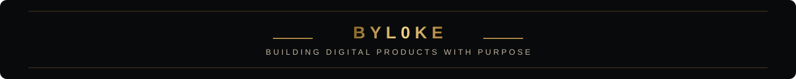

<!--
  BYL0KE · EXECUTIVE EDITION
  Perfil profesional de GitHub, negro y dorado.
  Animaciones SVG sobrias; sin JavaScript ni CSS personalizado (GitHub no lo permite en README).
  El diseño ejecutivo no implica una certificación ni años de experiencia no acreditados.
-->

<div align="center">
  
  <br/><br/>
  
  <br/>
  
  
  
  <br/><br/>
  <a href="#perfil-profesional">Perfil</a> ·
  <a href="#servicios">Servicios</a> ·
  <a href="#portfolio-digital">Portfolio</a> ·
  <a href="#tecnologías">Tecnologías</a> ·
  <a href="#metodología">Metodología</a> ·
  <a href="#actividad-en-github">Actividad</a> ·
  <a href="#contacto">Contacto</a>
</div>

<br/>

## Perfil profesional

Soy **BYL0KE**, desarrollador y creador de proyectos digitales. Combino la **ejecución técnica**, el **diseño de interfaces** y una visión orientada a producto para construir webs, sistemas y experiencias digitales con una identidad cuidada.

Trabajo especialmente en desarrollo web, ecosistemas **FiveM**, tiendas online, automatizaciones y presentación de marcas. Mi objetivo es que cada proyecto resuelva una necesidad real y transmita **confianza, claridad y profesionalidad**.

<table>
<tr>
<td width="33%" valign="top">
<strong>01 / INGENIERÍA</strong>
<p>Arquitectura de funcionalidades, desarrollo web, interfaces y soluciones personalizadas.</p>
</td>
<td width="33%" valign="top">
<strong>02 / PRODUCTO</strong>
<p>Experiencias pensadas para el usuario: navegación, procesos, conversión y mantenimiento.</p>
</td>
<td width="33%" valign="top">
<strong>03 / IDENTIDAD</strong>
<p>Diseño de marca, estética consistente y una presencia digital diferenciada.</p>
</td>
</tr>
</table>

<div align="center"></div>

## Servicios

| Especialidad | Soluciones |
|:--|:--|
| **Desarrollo web** | Webs corporativas, landing pages, portfolios, tiendas y experiencias responsive. |
| **FiveM & roleplay** | Sistemas, recursos Lua, interfaces, estructuras ESX/QBCore y tiendas Tebex. |
| **Aplicaciones y paneles** | Dashboards, catálogos, formularios, sistemas de gestión e interfaces de administración. |
| **Automatización e IA** | Chatbots, flujos de atención, registros y procesos digitales integrados. |
| **Diseño de producto** | Identidad visual, prototipado UI, banners, presentaciones de marca y microanimaciones. |

**Mi propuesta de valor:** transformar una idea en un producto digital coherente, funcional y preparado para seguir evolucionando.

---

## Portfolio digital

<sub>Selección de marcas y proyectos que desarrollo o en los que trabajo. Los proyectos privados o sin enlace público se identifican como tales.</sub>

<table>
<tr>
<td width="50%" valign="top">
<h3>01 · VisionV Studios</h3>
<p><strong>FiveM / Comercio digital</strong></p>
<p>Concepto de tienda de scripts y recursos para servidores de roleplay, con enfoque en experiencia de compra y presentación de producto.</p>
<a href="https://visionv-studios.tebex.io"></a>
</td>
<td width="50%" valign="top">
<h3>02 · TNT Racing</h3>
<p><strong>Automoción / Web de negocio</strong></p>
<p>Presencia digital para un taller, con secciones de servicios, contenidos de marca y una línea de tienda online.</p>
<a href="https://www.tntracing.es"></a>
</td>
</tr>
<tr>
<td width="50%" valign="top">
<h3>03 · Synkope Network</h3>
<p><strong>Tecnología / FiveM / Servicios</strong></p>
<p>Proyecto de marca digital dedicado al desarrollo, sistemas para roleplay, herramientas y servicios tecnológicos.</p>

</td>
<td width="50%" valign="top">
<h3>04 · Alantis Motors Luxury</h3>
<p><strong>Automoción de lujo / Marca digital</strong></p>
<p>Propuesta de marca y experiencia web para el sector premium, con foco en presentación, catálogo y posicionamiento.</p>

</td>
</tr>
<tr>
<td width="50%" valign="top">
<h3>05 · Alantis Sport</h3>
<p><strong>Ecommerce / Deporte</strong></p>
<p>Proyecto de tienda deportiva con catálogo, identidad de marca y experiencia orientada a comercio electrónico.</p>

</td>
<td width="50%" valign="top">
<h3>06 · Casa Adolfo</h3>
<p><strong>Restauración / Digitalización</strong></p>
<p>Proyecto web para presentar un restaurante, sus especialidades y su carta en un entorno claro y accesible.</p>

</td>
</tr>
</table>

<div align="center"></div>

## Tecnologías

<div align="center">
  
  <br/><br/>
  
  
  
</div>

---

## Metodología

**Disciplina en el proceso. Precisión en el resultado.**

```text
DISCOVER        → Objetivos, necesidades y público
DESIGN          → Estructura, identidad y prototipo
DEVELOP         → Implementación, lógica e interfaces
VALIDATE        → Pruebas, adaptación y correcciones
DELIVER         → Publicación, documentación y evolución
```

<details>
<summary><strong>Ver criterios de calidad</strong></summary>

- Interfaces claras y coherentes con la marca.
- Diseño adaptable a distintos dispositivos.
- Funciones útiles antes que elementos decorativos.
- Código organizado y cambios versionados cuando corresponde.
- Posibilidades de mantenimiento y evolución futura.

</details>

---

## Actividad en GitHub

<div align="center">
  
  
</div>

<details>
<summary><strong>Ver gráfica de contribuciones</strong></summary>

<div align="center">

</div>

</details>

<div align="center">
  <p><strong>CONTRIBUTION ACTIVITY</strong></p>
  <picture>
    <source media="(prefers-color-scheme: dark)" srcset="https://raw.githubusercontent.com/Byl0ke/Byl0ke/output/github-snake-dark.svg" />
    <source media="(prefers-color-scheme: light)" srcset="https://raw.githubusercontent.com/Byl0ke/Byl0ke/output/github-snake.svg" />
    
  </picture>
</div>

---

## Contacto

¿Tienes una idea, una web que desarrollar o un proyecto que necesita una identidad más profesional? **Hablemos de cómo convertirlo en una solución digital.**

<div align="center">
  <a href="https://github.com/Byl0ke"></a>
  <a href="https://www.youtube.com/@Byl0ke"></a>
  <a href="https://visionv-studios.tebex.io"></a>
  <br/><br/>
  
  <br/><br/>
  
</div>

<!-- Algunas estadísticas se renderizan mediante proveedores externos; pueden tardar o fallar temporalmente. -->
