<!--
  Perfil de GitHub · BYL0KE
  Los recursos gráficos están en /assets y tienen versión para el tema claro y el oscuro de GitHub.
-->

<picture>
  <source media="(prefers-color-scheme: dark)" srcset="https://raw.githubusercontent.com/Byl0ke/Byl0ke/main/assets/header-dark.svg">
  <source media="(prefers-color-scheme: light)" srcset="https://raw.githubusercontent.com/Byl0ke/Byl0ke/main/assets/header-light.svg">
  
</picture>

Soy **BYL0KE**, desarrollador de software y fundador de **VisionV Studios**. Diseño y desarrollo scripts y sistemas para servidores de **FiveM** (ESX y QBCore), webs a medida y productos digitales con una identidad de marca cuidada.

Mi forma de trabajar une código, diseño de interfaz y visión de producto: cada proyecto tiene que ser sólido por dentro, claro por fuera y útil para quien lo usa.

## Especialidades

<table>
  <tr>
    <td width="50%" valign="top">
      <strong>FiveM y roleplay</strong> 
      Scripts en Lua, sistemas para ESX y QBCore, interfaces NUI y tiendas en Tebex.
    </td>
    <td width="50%" valign="top">
      <strong>Desarrollo web</strong> 
      Webs corporativas, landing pages, tiendas online y paneles de gestión.
    </td>
  </tr>
  <tr>
    <td width="50%" valign="top">
      <strong>Automatización e IA</strong> 
      Chatbots, flujos de atención al cliente y procesos digitales integrados.
    </td>
    <td width="50%" valign="top">
      <strong>Diseño de producto</strong> 
      Identidad visual, prototipado de interfaces y presentación de marca.
    </td>
  </tr>
</table>

## Proyectos

| Proyecto | |
|:--|--:|
| **VisionV Studios** Tienda de scripts y recursos para servidores de roleplay en FiveM. | [Tienda ↗](https://visionv-studios.tebex.io) |
| **TNT Racing** Web corporativa para un taller de motos en Orihuela Costa. | [Web ↗](https://www.tntracing.es) |
| **Alantis Sport** Tienda online de deporte: catálogo, identidad de marca y experiencia de compra. | [Demo ↗](https://byl0ke.github.io/alantis-sport/) |
| **Synkope Network** Marca tecnológica de desarrollo, sistemas para roleplay y servicios digitales. | EN DESARROLLO |
| **Alantis Motors Luxury** Marca y experiencia web para el sector de la automoción premium. | EN DESARROLLO |
| **Casa Adolfo** Web para un restaurante: especialidades y carta en un entorno claro y accesible. | SIN ENLACE PÚBLICO |

## Tecnologías

<picture>
  <source media="(prefers-color-scheme: dark)" srcset="https://raw.githubusercontent.com/Byl0ke/Byl0ke/main/assets/stack-dark.svg">
  <source media="(prefers-color-scheme: light)" srcset="https://raw.githubusercontent.com/Byl0ke/Byl0ke/main/assets/stack-light.svg">
  
</picture>

También trabajo con VS Code y Photoshop.

## Contacto

¿Tienes un proyecto en mente o necesitas un sistema a medida para tu servidor? Hablemos.

  <a href="https://visionv-studios.tebex.io"><picture><source media="(prefers-color-scheme: dark)" srcset="https://raw.githubusercontent.com/Byl0ke/Byl0ke/main/assets/buttons/tienda-dark.svg"><source media="(prefers-color-scheme: light)" srcset="https://raw.githubusercontent.com/Byl0ke/Byl0ke/main/assets/buttons/tienda-light.svg"></picture></a>
  <a href="https://www.youtube.com/@Byl0ke"><picture><source media="(prefers-color-scheme: dark)" srcset="https://raw.githubusercontent.com/Byl0ke/Byl0ke/main/assets/buttons/youtube-dark.svg"><source media="(prefers-color-scheme: light)" srcset="https://raw.githubusercontent.com/Byl0ke/Byl0ke/main/assets/buttons/youtube-light.svg"></picture></a>
  <a href="https://www.twitch.tv/byl0k"><picture><source media="(prefers-color-scheme: dark)" srcset="https://raw.githubusercontent.com/Byl0ke/Byl0ke/main/assets/buttons/twitch-dark.svg"><source media="(prefers-color-scheme: light)" srcset="https://raw.githubusercontent.com/Byl0ke/Byl0ke/main/assets/buttons/twitch-light.svg"></picture></a>
  <a href="https://www.patreon.com/Byl0ke"><picture><source media="(prefers-color-scheme: dark)" srcset="https://raw.githubusercontent.com/Byl0ke/Byl0ke/main/assets/buttons/patreon-dark.svg"><source media="(prefers-color-scheme: light)" srcset="https://raw.githubusercontent.com/Byl0ke/Byl0ke/main/assets/buttons/patreon-light.svg"></picture></a>
  <a href="https://x.com/byl0k"><picture><source media="(prefers-color-scheme: dark)" srcset="https://raw.githubusercontent.com/Byl0ke/Byl0ke/main/assets/buttons/x-dark.svg"><source media="(prefers-color-scheme: light)" srcset="https://raw.githubusercontent.com/Byl0ke/Byl0ke/main/assets/buttons/x-light.svg"></picture></a>

 

<picture>
  <source media="(prefers-color-scheme: dark)" srcset="https://raw.githubusercontent.com/Byl0ke/Byl0ke/main/assets/footer-dark.svg">
  <source media="(prefers-color-scheme: light)" srcset="https://raw.githubusercontent.com/Byl0ke/Byl0ke/main/assets/footer-light.svg">
  
</picture>
